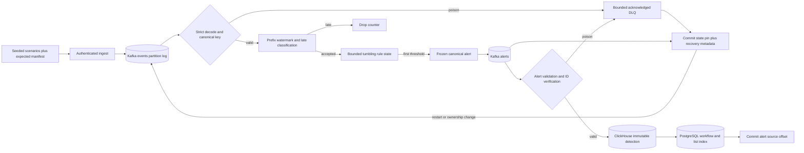

# Phase 3: Detection & Alert Pipeline - Research

**Researched:** 2026-10-17
**Domain:** deterministic event-time detection, Kafka replay, immutable detection storage and mutable alert workflows
**Confidence:** HIGH for existing contracts and pinned APIs; MEDIUM for the proposed recovery policy until implementation tests prove it.

## User Constraints

No Phase 3 CONTEXT.md exists. The approved story supplied by the orchestrator is: “As an operator, I want deterministic, evidence-backed alerts from malicious traffic, so that crashes, restarts and replay cannot lose or duplicate detections.” [VERIFIED: orchestrator task; init.phase-op 3]

Inherited decisions are epoch-aligned tumbling windows with state-pin replay recovery, PostgreSQL as the alert list index with `seq`, ClickHouse immutable detections/PostgreSQL mutable workflows, and the existing versioned contracts. Write the window/state-pin ADR and concrete list-source ADR **before rule-code execution**. These choices are already recorded in STATE.md and ROADMAP.md; the detailed policies recommended below are research proposals, not existing user locks. [VERIFIED: .planning/STATE.md; .planning/ROADMAP.md Phase 3; docs/decisions/0006-alert-storage-split.md]

The relevant Phase 1 decisions are copied verbatim: [VERIFIED: .planning/phases/01-foundations-contracts/01-CONTEXT.md D-15/D-16]

- **D-15:** A single function, `contracts.DedupeKey(tenant, ruleID, entityKey, windowStart)`, builds the canonical key. It uses length-prefixed fields, UTC, millisecond precision, and returns lowercase SHA-256 hex as `alert_id`.
  - `entity_key` components are length-prefixed too, so a `|` inside a value cannot collide.
  - The human-readable `dedupe_key` string from spec §6.2 is kept as a display field only.
  - The function is fuzz-tested (`go test -fuzz`) for injectivity on `|`-containing inputs.
  - It lives in Phase 1 even though the rules come in Phase 3.
- **D-16:** Alert schema per spec §6.2.
  - `created_at` is defined as event-time-derived (window end or triggering event time).
  - An optional non-key `detected_at` (wall clock) is reserved for the delay metric.
  - `sample_event_ids` holds at most 20 entries.
  - `severity` enum: `low`, `medium`, `high`, `critical`.
  - `status` enum: `open`, `acknowledged`, `resolved`.

Rules load at startup; UI, JWT/triage endpoints and SSE implementation belong to Phase 4. AI/ML belongs to a deferred milestone. This phase is a deterministic backend slice and does not require UI-SPEC.md or AI-SPEC.md. Preserve stable identity goldens: `rule_version` is **not** an input to `contracts.DedupeKey`. [VERIFIED: .planning/REQUIREMENTS.md DET-05; .planning/ROADMAP.md Phase 4; .planning/PROJECT.md Out of Scope; backend/internal/contracts/dedupe.go]

## Project Constraints (from AGENTS.md)

No root AGENTS.md, `.codex/skills/`, `.agents/skills/`, or `.planning/graphs/graph.json` was found during discovery. There are no additional project-skill rules or graph results to apply. The old `.planning/codebase/` map is explicitly stale; actual Phase 1/2 code and accepted ADRs are the implementation source of truth. [VERIFIED: filesystem discovery; .planning/PROJECT.md Context]

Apply the project's recorded constraints: single Go module/multiple binaries; at-least-once effects; bounded resources; parameterized SQL; synthetic documentation IPs and pseudonymous principals; no secrets/raw request bodies in logs; no IP/user/tenant/event-ID metric labels; real dependency integration tests; no invented performance or correctness results. [VERIFIED: .planning/PROJECT.md Constraints; spec.md §§2, 3, 10, 11, 15, 18]

<phase_requirements>
## Phase Requirements

The following descriptions reproduce REQUIREMENTS.md. Research support identifies the proposed implementation/validation path. [VERIFIED: .planning/REQUIREMENTS.md Detection, Alert Pipeline, Generator]

| ID | Description | Research Support |
|---|---|---|
| DET-01 | The detector evaluates AUTH_BRUTE_FORCE (≥10 failures / 5 min, by tenant+source_ip+principal) on event time [FR-04] | Predicate table; pure reducer and seeded exact fixtures |
| DET-02 | The detector evaluates PORT_SCAN (≥20 distinct ports / 60 s, by tenant+source_ip+destination_ip) on event time [FR-04] | Exact bounded distinct-port set; duplicate-port negative fixtures |
| DET-03 | The detector evaluates REQUEST_FLOOD (≥300 requests / 60 s, by tenant+source_ip) on event time [FR-04] | `net.request` predicate; 299/300/301 tests |
| DET-04 | The detector evaluates DENY_SPIKE (≥30 denies / 2 min, by tenant+source_ip) on event time [FR-04] | `policy.decision` + `action=deny`; 29/30/31 tests |
| DET-05 | Rule thresholds, windows, severities and cooldowns load from versioned `config/rules.yaml` at startup, and changing them requires a restart (documented) [§5.1] | Strict YAML; bounded settings; metadata fingerprint/version-drain guard |
| DET-06 | The window model is documented in an ADR and tested: event-time windows with half-open boundaries, a per-partition watermark, a ~30 s lateness tolerance, deterministic late-event handling with a metric, and bounded per-key state [§5.1] | Window/recovery ADR first; prefix watermark and sealed floor; explicit bounds/late counter |
| DET-07 | Each rule hit produces one alert per dedupe key and window, carrying severity, summary, event_count, window start/end, at most 20 sample event IDs, rule_id/rule_version and a deterministic SHA-256 alert_id. created_at is derived from event time [FR-05, §6.2] | Frozen first-threshold payload; existing DedupeKey and alert validation |
| DET-08 | Per-rule cooldown suppresses repeat alerts for the same entity, while separate windows remain investigable [§5.1] | Explicit window-scoped candidate throttle versus permanent same-window identity dedupe |
| DET-09 | Seeded malicious fixtures trigger each rule exactly as expected, benign fixtures produce no alerts, and boundary/lateness fixtures behave as specified [§14 Phase 3] | Shared cross-language fixture manifest and exact observed-ID assertions |
| ALRT-01 | Alerts are published to `security.alerts.v1` (key `tenant_id|alert_id`) and the alert-writer persists immutable detections to ClickHouse [FR-05] | Bounded all-ISR publisher; native immutable store; immediate read dedupe |
| ALRT-02 | The alert-writer creates the mutable workflow row (status, assignee, version, seq, denormalized list fields) in PostgreSQL with a unique alert_id. A replayed detection never reopens or duplicates an existing alert [FR-05, §7.3] | INSERT ON CONFLICT DO NOTHING; immutable fingerprint guard; resolved-replay test |
| ALRT-03 | The detector rebuilds window state after restart or rebalance by replaying from a committed state-pin offset. Killing the detector mid-window (e.g. after 9 of 10 failures) still produces the alert once the 10th event arrives [FR-11, §5.1] | Metadata-aware consumer; 9/10 kill/restart and third-replica ownership handoff |
| ALRT-04 | A crash at each boundary (before alert publish, between publish and offset commit, after commit) is tested with failpoints and yields exactly one visible alert per dedupe key [FR-11, §14 Phase 3] | Integration-only private file barriers at all three boundaries |
| GEN-02 | A tester can inject scenarios (auth brute force, port scan, request flood, deny spike) via generator flags, with expected rule hits recorded [FR-09, §17] | Extend existing sender/manifest with deterministic scenario builder and expected detections |

</phase_requirements>

## Summary

The repository already supplies strict Event/Alert types, canonical SHA-256 identity, bounded all-ISR publishing, a commit-after-effects event writer, bounded quarantine publication, native ClickHouse operations, PostgreSQL/ClickHouse migration runners, integration-only barriers and real-container test helpers. Detector and alert-writer mains still contain dependency/health skeletons; `config/rules.yaml` contains `rules: []`. Reuse those foundations while giving the detector its own metadata-aware offset adapter: the existing `Consumer.CommitRecords` deliberately commits consumed-next offsets and cannot represent a state pin. [VERIFIED: backend/internal/contracts; backend/internal/kafkax; backend/internal/eventwriter; backend/internal/storage/clickhouse; backend/test/recovery_test.go; backend/cmd/{detector,alert-writer}/main.go; config/rules.yaml]

The hardest design issue is reconstruction of **decisions**, not only counters. A pin without the event-time maximum immediately before it can accept records previously classified late; initializing replay with the current maximum can instead reject records that originally built live state. A closed-window floor prevents partial replay of already sealed history. The proposed checkpoint therefore couples offset and bounded metadata, while deterministic first-threshold evidence remains reconstructible from retained Kafka records. This policy needs committed ADR text and adversarial implementation tests; it is not an already proven production guarantee. [ASSUMED: A1, recovery design derived from event-time/replay constraints]

**Primary recommendation:** Build an operator-visible Kafka detection slice first, then a complete alert-topic → ClickHouse/PostgreSQL persistence slice, then strengthen both with recovery, quarantine and Compose/seed acceptance. Keep ADRs before rule code and failure proofs attached to the behavior they protect. [ASSUMED: A2, planning recommendation]

## Architectural Responsibility Map

| Capability | Primary Tier | Secondary Tier | Rationale |
|---|---|---|---|
| Seeded malicious scenarios and expected outcomes | Producer/client | Existing authenticated ingest API | Reuse generator's seed/body/manifest contract. [VERIFIED: generator/src/sentinel_generator; GEN-02] |
| Event validation, lateness, grouping, windows, dedupe and cooldown | API/backend: detector | Kafka partition log/commit metadata | Source keys already co-locate each rule entity; recover state from ordered partition records. [VERIFIED: kafkax/producer.go; ASSUMED: A1] |
| Alert durability and recovery boundary | API/backend: detector | Kafka alerts topic and consumer-group offsets | Publish before checkpointing durable effects. [VERIFIED: spec.md §§3, 11.1; ASSUMED: A1] |
| Immutable evidence | Database/storage: ClickHouse | Alert-writer | Accepted storage split. [VERIFIED: ADR 0006] |
| Workflow state and alert list index | Database/storage: PostgreSQL | Alert-writer; later query-api | Unique identity and transactional workflow ownership. [VERIFIED: ADR 0006; REQUIREMENTS.md ALRT-02] |
| Analyst UI, status mutation, live fanout | Later Phase 4 backend/browser | PostgreSQL list index | Explicitly later scope. [VERIFIED: ROADMAP.md Phase 4] |

## Standard Stack

Use installed, pinned modules; no framework or runtime upgrade is needed for this phase. Version dates below came from `go list -m -json` in `backend/`, not remembered versions. They are the project's pins, not claims that every pin is registry-latest. [VERIFIED: backend/go.mod; Go module metadata queried 2026-10-17]

| Library/runtime | Pinned version; module publish date | Purpose | Provenance |
|---|---|---|---|
| Go | go1.26.9 toolchain; module go1.26.0 | Detector/writer and tests | [VERIFIED: backend/go.mod; `cd backend && go version`] |
| `github.com/twmb/franz-go` | v1.22.1; 2026-09-27 | Existing Kafka consumer/producer; checkpoint hooks | [VERIFIED: existing module metadata and pinned official source] |
| `github.com/twmb/franz-go/pkg/kmsg` | v1.14.0 | Commit/fetch metadata and partition error responses | [VERIFIED: backend/go.mod; pinned kgo signatures] |
| `github.com/ClickHouse/clickhouse-go/v2` | v2.49.0; 2026-10-08 | Existing native batch insertion and bound queries | [VERIFIED: module metadata; storage/clickhouse/events.go] |
| `github.com/jackc/pgx/v5` | v5.11.0; 2026-09-07 | Existing pool, transactions and workflow SQL | [VERIFIED: module metadata; internal/database/database.go] |
| `go.yaml.in/yaml/v3` | v3.0.5; 2026-07-26; currently indirect | Strict startup rule configuration | [VERIFIED: module metadata; pinned official yaml.go/ decode.go; Context7 /yaml/go-yaml] |
| Existing Python/pytest | Python 3.13.11; pytest 9.1.1 locked | Scenarios and expected manifest tests | [VERIFIED: `uv run --locked python --version`; generator/pyproject.toml] |

Supporting tools are the existing tern runner, chmigrate runner, contracts, testcontainers helpers, `scripts/go-test-nonempty.sh`, zerolog and lifecycle/ops packages. Do not replace these with parallel infrastructure. [VERIFIED: backend/internal/database/migrator.go; backend/internal/chmigrate; backend/internal/testing; scripts/go-test-nonempty.sh; backend/internal/app; backend/internal/opshttp]

**Installation:** None. Importing the already resolved YAML module will move it from indirect to direct when `go mod tidy` runs; preserve its version and verify the intentional go.mod/go.sum diff. No npm/pip/cargo packages are proposed. [VERIFIED: backend/go.mod; ASSUMED: A2, implementation prescription]

## Package Legitimacy Audit

No new external-package installation is planned, so the install-time slopcheck gate is not triggered. Existing dependencies are recorded above with local/pinned-source provenance, **not** labeled `[VERIFIED: npm registry]` and not asserted to have passed slopcheck. If implementation adds any new dependency, run the prescribed legitimacy gate and ecosystem registry checks before recommending installation. [VERIFIED: current dependency graph; ASSUMED: A2, no-new-dependency plan]

| Package change | Registry | slopcheck | Disposition |
|---|---|---|---|
| YAML indirect → direct, same v3.0.5 already in go.mod/go.sum | Go module graph already resolved | Not run; no new installation | Reuse existing official module; do not upgrade. [VERIFIED: backend/go.mod; local module source] |
| New npm/pip/cargo packages | None | Not applicable | None recommended. [ASSUMED: A2] |

Packages removed/flagged by slopcheck: none evaluated; no clean-verdict claim is made. [VERIFIED: research tool history]

## Architecture Patterns

### System architecture diagram

This diagram is the recommended data flow; arrows crossing databases are independently acknowledged effects, not a distributed transaction. [ASSUMED: A1/A3; VERIFIED: ADR 0006]



### Recommended project structure / component responsibilities

These are proposed paths within the existing module. Avoid making a generic stream-processing framework. [ASSUMED: A2]

| Component | Responsibility |
|---|---|
| `backend/internal/detection/` | Strict rules loader, pure partition reducer, bounded window/dedupe/cooldown state, checkpoint representation |
| `backend/internal/detector/` | Poll/process/publish/checkpoint lifecycle, ownership and failure boundaries |
| `backend/internal/kafkax/` | Detector-specific metadata consumer adapter and bounded alert publisher; retain event-writer behavior |
| `backend/internal/alertwriter/` | Alert classification, immutable insert, workflow ensure, DLQ and contiguous source commit |
| `backend/internal/storage/clickhouse/alerts.go` | Native immutable detection insertion and tenant-scoped immediate dedupe reads |
| `backend/internal/storage/postgres/alerts.go` | Insert-only workflow/list-index ensure and immutable-payload consistency guard |
| `backend/migrations/{clickhouse,postgres}/003_*.sql` | Additive schemas; migration runners already embed these directories |
| `generator/src/sentinel_generator/scenarios.py` | Fixed-seed scenarios, progress markers and expected detection manifest |
| `backend/test/detector*_test.go`, `alert*_test.go` | Real pipeline, poison, checkpoint, replica and crash acceptance |

### Pattern 1: strict finite rules and exact predicates

Defaults for thresholds/windows/grouping come from spec §5.1; exact event-type predicates below operationalize its prose using the established event enum. Missing required grouping fields mean “no match”, not a synthetic empty principal/destination. [VERIFIED: spec.md §5.1; contracts/event.go; ASSUMED: A4, exact predicate interpretation]

| Rule | Predicate | Entity components after tenant | Threshold / window |
|---|---|---|---|
| AUTH_BRUTE_FORCE | `event_type == auth.failure`; non-null source_ip and nonempty principal | source_ip, principal | 10 unique events / 300 s |
| PORT_SCAN | `event_type == net.connection`; source_ip, destination_ip, destination_port present | source_ip, destination_ip | 20 exact distinct destination ports / 60 s |
| REQUEST_FLOOD | `event_type == net.request`; source_ip present | source_ip | 300 unique events / 60 s |
| DENY_SPIKE | `event_type == policy.decision && action == deny`; source_ip present | source_ip | 30 unique events / 120 s |

Decode one capped YAML document with `KnownFields(true)`, require EOF, reject duplicate rule IDs, unsupported IDs/enums, missing fields, nonpositive durations/thresholds, integer overflow and unsupported schema version. Use `yaml.Node` checks if forbidding aliases/merge keys is part of the selected config policy; test duplicates rather than assuming struct decoding alone covers every schema shape. The pinned v3 source supplies `KnownFields` and duplicate mapping-key diagnostics; Context7 also returns newer loader APIs that **must not** be copied into this v3 pin. [VERIFIED: go.yaml.in/yaml/v3@v3.0.5/yaml.go, decode.go; Context7 /yaml/go-yaml; ASSUMED: A4, loader policy]

Select explicit checked-in severity/cooldown defaults in the ADR/config plan: proposed AUTH high/60s, SCAN medium/30s, FLOOD high/30s, DENY medium/60s, enabled=true/version=1. The spec does not establish these severity/cooldown values; they are implementation choices requiring recorded acceptance rather than claims of spec mandates. [ASSUMED: A4]

### Pattern 2: event-time windows and frozen evidence

Recommended window policy: normalize to UTC milliseconds; `start = floor(unix_ms / window_ms) * window_ms`, `end = start + window_ms`, membership `[start,end)`. Partition watermark is `max(valid occurred_at seen in partition) - 30s`. Accept equality at the watermark; drop `occurred_at < watermark` with a bounded-label counter. Expire windows only when `end <= watermark`. A valid nonmatching event advances the maximum; a poison record does not. Neither idle polls nor host wall clock advances event time. [ASSUMED: A1; VERIFIED: spec.md §5.1 requires event time/bounded state/lateness]

Use unique event IDs inside a rule/entity/window, plus an exact distinct-port set for SCAN. Sample evidence is the first at most 20 accepted unique event IDs in Kafka partition order. On the first threshold crossing freeze the entire immutable alert: event_count is the number of accepted unique matching events at that crossing (SCAN counts ports for its predicate but matching events for evidence), created_at=window_end, status=open, and deterministic summary. Omit optional detected_at from canonical Kafka payloads; wall-clock metrics can record detection time separately. Retain fired window identity and its first source offset until expiration. Do not enlarge/reorder frozen evidence on later hits or retries. [ASSUMED: A1/A4; VERIFIED: contracts/alert.go; Phase 1 D-16]

Require the canonical Kafka key `tenant_id|source_ip` (empty final component when source_ip is null, matching the existing producer) before applying state, and quarantine mismatches. Null source_ip remains schema-valid but matches none of these four rules. This preserves per-entity partition ownership; keep the existing fixed event-partition count. Do not hash the human display entity string to derive IDs: pass the component slice to existing `DedupeKey`. [VERIFIED: kafkax/producer.go recordsFor; contracts/dedupe.go; deployments/compose/docker-compose.yml; ASSUMED: A4, mismatch quarantine]

### Pattern 3: a checkpoint is pin plus prefix decision context

Recommended per-partition metadata, encoded as a small versioned bounded object: [ASSUMED: A1]

```json
{"format":1,"config_fingerprint":"<sha256>","rule_versions":{"AUTH_BRUTE_FORCE":1,"PORT_SCAN":1,"REQUEST_FLOOD":1,"DENY_SPIKE":1},"prefix_max_event_time":1760000000000,"sealed_through":1760000030000,"drained":false}
```

- `pin` is the earliest first source offset of **all** currently unexpired window states, including fired windows and their dedupe state. With no state, commit the processed next offset. It is a Kafka resume offset, not “last processed offset + 1” in the active-state case. [ASSUMED: A1]
- `prefix_max_event_time` is the maximum valid occurred_at **immediately before pin**, not the current maximum. Maintain a bounded metadata-only offset→prefix-maximum ledger while processing; prune only offsets older than the successfully committed pin. Do not retain complete source payloads in this ledger. [ASSUMED: A1]
- `sealed_through` is the current partition watermark **only after all alerts and poison effects in the processed prefix have been acknowledged durably**. Publish acknowledgements must precede both window retirement/checkpoint advancement and adoption of the sealed floor. If any effect is incomplete, keep the prior committed checkpoint and terminate/retry boundedly; replay restores volatile state. [ASSUMED: A1]
- Rebuild from pin using its prefix maximum for lateness decisions. Update the maximum from every valid record. Skip rule windows with `end <= saved sealed_through` during reconstruction; preserve and rebuild later windows. The saved sealed floor is a suppression boundary, not the initial lateness watermark. [ASSUMED: A1]
- Capture each checkpoint's metadata and offsets atomically in one OffsetCommit request, restore via `OnOffsetsFetched`, and reject missing/malformed/unknown metadata on an existing committed position. New groups start at retained earliest with an explicit documented retained-history boundary. Returning an error from OnOffsetsFetched retries the group session, so propagate terminal validation failure to the worker/lifecycle as well; do not loop forever while ready. [VERIFIED: pinned kgo/config.go OnOffsetsFetched; ASSUMED: A1]

**Why both time fields matter:** A progress marker at t=300000 precedes the pin; active AUTH records at t=280000 follow it; an out-of-order t=269999 record was dropped under watermark 270000. Replay without prefix_max can count that dropped record and trigger an extra first hit. Conversely, initializing replay at a later current watermark can discard the original active contributors. When a pin advances beyond the first record of an already closed window, replaying the remaining suffix can reconstruct a different first-threshold payload for that old ID; sealed_through prevents this. These are design counterexamples, not measured production failures. [ASSUMED: A1, analytical counterexamples]

**Required recovery invariant:** For each unexpired window, all originally accepted contributors since its first offset remain at/after pin. The saved prefix maximum reproduces the late/accepted decision sequence. The sealed floor removes only windows whose effects were already durable. Hence replay must reconstruct counts, dedupe IDs, exact port sets, evidence order and first-threshold bytes for every remaining window. Test this after multiple successive pin advances with interleaved entities/rules and out-of-order/late/duplicate inputs. [ASSUMED: A1, proof obligation]

Research executed a small in-memory model over 30 deterministic streams/690 restart cuts: live state and the union of canonical outputs matched uninterrupted execution. It exercised out-of-order timestamps, duplicate IDs, three entities and four rule window/threshold settings. This is exploratory model evidence only; dense threshold coverage, real client callbacks, bounded memory and production recovery are unverified until the proposed Go/real-Kafka tests pass. The model is not an acceptance artifact or a substitute for checked-in tests. [VERIFIED: research tool execution, 2026-10-17]

### Pattern 4: explicit bounds and fail-closed recovery

Proposed configurable starting bounds, not benchmark-derived capacity claims: rule file 64 KiB; only four known rule IDs; window 1s..1h; threshold 1..4096 (SCAN ≤65536 and ≤selected distinct-set cap); active windows 10,000/process; unique IDs 4096/window; source-offset ledger 100,000 entries/process; tracked state 64 MiB/process; checkpoint metadata 1024 bytes/partition. Validate cross-field constraints, arithmetic and aggregate fetch/producer/state budgets. Use lower overrides for deterministic capacity tests. [ASSUMED: A5]

Stop before admitting a state-changing record that would exceed a cap; mark not-ready and return a sanitized terminal error without committing beyond recoverable state. Do not evict unexpired state, probabilistically count ports, or silently discard ledger entries. Continuing dense traffic at one event-time instant can fill the offset ledger even with few windows; “bounded time horizon” alone does not bound memory. [ASSUMED: A1/A5]

Use `ConsumeStartOffset(NewOffset().AtStart())` with `ConsumeResetOffset(NoResetOffset())`, plus explicit log-start/end validation against the committed pin at assignment and guards for data-loss errors during consumption. A trimmed pin, truncation, malformed metadata or lost ownership fails closed; never silently seek to retained earliest/latest to make the service healthy. Kafka offset metadata defaults to a 4096-byte cap in official 4.3 configuration, so keep metadata compact and independently bounded. [VERIFIED: pinned kgo/config.go and consumer.go; CITED: kafka.apache.org/43/configuration/broker-configs/#offset.metadata.max.bytes; ASSUMED: A1, guard policy]

Idle partitions keep their pins until event time progresses; this is a documented availability/retention tradeoff. Scenarios/demo drain send schema-valid `auth.success` progress markers using the same source keys/partitions, at sufficient event time to expire their windows. Production retention must cover the oldest pin plus downtime/catch-up; no retention-duration guarantee is inferred from the 24h local default. A detector failing closed after lost retention cannot reconstruct deleted evidence. [VERIFIED: Compose local retention; ASSUMED: A1/A5]

### Pattern 5: cooldown scope must be explicit

Recommended v1 interpretation is cooldown per `(rule, tenant, entity, window_start)`. First threshold crossing freezes/publishes the canonical alert; event-time cooldown throttles repeat candidate attempts within that window. Even after cooldown elapses, same-window identity dedupe suppresses another unique alert. A new window resets candidate eligibility and retains a separately investigable identity. Use a monotone event-time clock within this state so out-of-order records cannot rewind cooldown. [ASSUMED: A6, explicit interpretation of DET-08/roadmap criterion 2]

**Limitation:** This policy does not implement cross-window suppression and does not reduce the number of unique visible alerts beyond the one-ID-per-window guarantee. It changes repeat-candidate work/counters, not the unique-window alert count. State this plainly in the ADR, rule docs and tests; do not claim a stronger interpretation of DET-08 is proven. Test two thresholds/windows closer together than cooldown, same-window candidates before/at/after cooldown and replay of all of them. [ASSUMED: A6]

If cross-window greedy cooldown is required, the above policy is insufficient. An arbitrarily old emitted hit can decide whether the next is suppressed, which then decides the next; fixed lookback alone cannot seed this chain correctly. A sound stronger design must durably checkpoint per-entity cooldown seeds immediately before pin (with bounded capacity/metadata and recovery tests), or use another explicitly selected durable state store. An infinite pin or processing-time cooldown is not an acceptable shortcut. Do not silently implement that larger design under the window-scoped label. [ASSUMED: A6, alternative analysis]

### Pattern 6: immutable config while active replay exists

Fingerprint the canonical parsed rule definitions and all decision-affecting settings, including lateness/predicate/window/evidence/cooldown semantics. Persist the fixed four-rule version manifest alongside the fingerprint so restart can distinguish same-version edits from an intentional version transition. Equal version with changed fingerprint is rejected. Configuration changes require a coordinated drain using old config until no active state pins remain, checkpoint a handover boundary, stop old replicas, then restart with increased rule versions. The handover also needs an explicit bounded `drained` marker or equivalent verified boundary; the new process cannot infer absence of active state from the offset alone. Verify restart metadata permits only this drained transition; unknown/mixed fingerprints on active state fail closed. Do not hot reload, reinterpret old windows with new thresholds, or change DedupeKey to incorporate version. [ASSUMED: A7; VERIFIED: DET-05; existing contracts/dedupe.go excludes version]

### Pattern 7: idempotent two-store alert writer

Validate alert schema, canonical identity consistency and `tenant|alert_id` Kafka key. For a new valid alert: insert immutable ClickHouse detection with a fresh native batch; ensure PostgreSQL workflow row with parameterized `INSERT ... ON CONFLICT (alert_id) DO NOTHING`; then commit only the partition-contiguous durable source prefix. ClickHouse success/PostgreSQL failure is an expected partial state and is repaired by replay; never commit source offset after only one sink. [VERIFIED: spec.md §§7.3, 11.1; ADR 0006; PostgreSQL 18 INSERT docs; ASSUMED: A3, exact writer sequence]

Proposed PostgreSQL fields: globally unique `alert_id` primary key, tenant_id, status=open, nullable assignee, version=1, seq bigint identity unique, updated_at, and immutable list fields (created_at, rule_id/version, severity, entity, summary, event_count, window bounds) plus a canonical immutable payload fingerprint. Index tenant+(created_at,alert_id), tenant+(status,created_at,alert_id), and tenant+seq. Never overwrite existing status, assignee, version, updated_at or seq on replay. Before accepting a conflict, read the winner with its tenant and immutable fingerprint; same ID with a different tenant/payload is a bounded quarantine event, not a successful arbitrary upsert. [ASSUMED: A3]

Use a per-alert transactional advisory lock or equivalent keyed serialization around conflict preflight/CH insert/PG ensure when multiple writers can overlap. Existing winner is authoritative: identical payload may be safely skipped; differing immutable payload is quarantined before adding a conflicting CH row. On a crash after CH success but before PG creation, inspect retained CH content for the same tenant/ID and enforce the same consistency rule before creating PG. Document that CH physical duplicates are permitted, but reads/counts dedupe immediately and conflicting payloads are not silently declared equivalent. A practical alternative is deterministic canonical payload selection with explicit first-winner policy; do not leave it unspecified as event ADR 0002 does for conflicting event content. [ASSUMED: A3, conflict/concurrency policy]

Store CH alerts ordered with stable `(tenant_id,alert_id)` identity and an explicit UTC millisecond timestamp; query duplicate-safe counts/detail before merges, including across partitions if partitioning by time. Do not assert ReplacingMergeTree alone gives immediate uniqueness. PG provides alert list pagination/filtering first; details/evidence join CH afterward under the same trusted tenant. Alert TTL and workflow/audit retention are **not** specified here: no compliance period is invented. [CITED: clickhouse.com/docs/concepts/features/operations/update/replacing-merge-tree; VERIFIED: ADR 0006; ASSUMED: A3]

`seq` allocation is not transaction commit order: a lower allocated sequence can commit after a higher one. Phase 4 must not treat identity allocation alone as a gap-free live-feed watermark. If a shared PostgreSQL advisory lock serializes all insert transactions before allocating seq, document and test that ordering/throughput tradeoff; otherwise Phase 4 needs an appropriate backfill design. This phase creates/tests the column and preserves it across replay, not a speculative SSE implementation. [CITED: www.postgresql.org/docs/18/functions-sequence.html; ASSUMED: A3, concurrency inference]

### Ownership, poison and lifecycle

Give the detector and alert-writer independent group IDs/topic settings; do not reuse the event-writer group. Block rebalances during bounded owned batches. On revoke commit only completed checkpoint/effects while ownership is valid, then clear only revoked partitions. On loss clear state without attempting new effects/commits. On reassign fetch/validate checkpoint metadata and rebuild before serving work as ready. Do not make synchronous Close/LeaveGroup calls inside callbacks. [VERIFIED: pinned kgo/config.go callbacks; Context7 /twmb/franz-go; ASSUMED: A1/A3]

Reuse the bounded existing DLQ envelope/header sanitizer and aggregate poison deadline for both workers. Permanent schema/key/identity poison goes to `security.events.dlq.v1` with origin topic/partition/offset, so alert-origin poison remains identifiable; never consume DLQ as detector input. Transient sink failures, retention loss and capacity exhaustion are terminal/retry conditions, not poison. A DLQ failure must prevent committing past that record within its partition; other durable partitions may progress independently. Preserve the Phase 2 event-writer regression behavior. [VERIFIED: internal/kafkax/dlq.go; internal/eventwriter/writer.go; spec.md §11.1; ASSUMED: A1/A3, worker policies]

## Don't Hand-Roll

| Problem | Don't build | Use instead | Why |
|---|---|---|---|
| Alert identity | New hashes/version fields/delimiter encoding | Existing `contracts.DedupeKey` | Accepted goldens define stable identity. [VERIFIED: contracts/dedupe.go/test] |
| Kafka protocol/group membership | Direct coordinator client or ad hoc heartbeat loop | Pinned franz-go hooks | APIs support metadata and callbacks. [VERIFIED: pinned kgo source] |
| Poison envelopes | New uncapped headers/raw error text | Existing DLQPublisher | Existing output framing/header/deadline limits are tested. [VERIFIED: kafkax/dlq.go/test; eventwriter/writer.go] |
| SQL escaping | Interpolated tenant/entity strings | pgx parameters / ClickHouse named parameters | Existing storage convention and required security boundary. [VERIFIED: events.go; PROJECT.md] |
| YAML parsing | String splitting or executable rule DSL | Existing yaml/v3 Decoder | Known fields and duplicate-key diagnostics are available. [VERIFIED: pinned yaml source] |
| Failure orchestration | Public HTTP kill switches or sleeps | Integration-tag private file barriers | Existing default builds are no-op. [VERIFIED: eventwriter/failpoint*.go; recovery_test.go] |

An exact port set and a small pure deterministic reducer are appropriate domain code; a general stream processor, Bloom-filter cardinality or Redis-only recoverable counters are not required. [ASSUMED: A2; VERIFIED: spec.md §7.4]

## Common Pitfalls

| Pitfall | What goes wrong / warning sign | Prevention |
|---|---|---|
| Consumed-next offset used as checkpoint | 9/10 state disappears after crash | Earliest live pin including fired state, with metadata-aware commits. [ASSUMED: A1] |
| Wrong watermark seed | Late record becomes accepted, or original evidence disappears | Prefix max immediately before pin; sealed floor separate. [ASSUMED: A1] |
| Closed history recreated after pin advances | Same ID acquires a different first-threshold sample set | Skip windows at/before durable sealed floor. [ASSUMED: A1] |
| Assumed CommitOffsetsSync return error | Code does not compile or ignores partition commit failures | Capture callback transport error and every response ErrorCode; propagate failure. [VERIFIED: pinned consumer_group.go; kmsg OffsetCommitResponse] |
| Unacknowledged publish followed by commit | Alert is lost at crash boundary | All-ISR ack first; ambiguous publish may replay identical bytes. [VERIFIED: spec.md §11.1; ASSUMED: A1] |
| Window eviction at threshold or wall-clock idle cleanup | Replay loses frozen payload/eligibility | Retain to event-time expiration; fail closed on retention/capacity loss. [ASSUMED: A1] |
| Per-record retry deadline multiplied by poison count | Rebalance timeout/memory blowup | One aggregate owned-batch/effects budget, existing Phase 2 pattern. [VERIFIED: eventwriter/writer.go; writer_rebalance_test.go] |
| Naive workflow upsert | Resolved alert reopens or seq/version changes | Insert-only conflict path; assert all mutable fields unchanged. [VERIFIED: ALRT-02; ASSUMED: A3] |
| Random benign generator treated as zero-alert proof | Accidental scenario grouping can satisfy thresholds | Construct an explicit benign fixture; exact expected manifest. [VERIFIED: current events.py random fields; ASSUMED: A4] |
| Regex integration command matches nothing | Green CI proves no Phase 3 behavior | Existing nonempty runner and named behavior groups. [VERIFIED: scripts/go-test-nonempty.sh] |

## Code Examples

### Pinned commit metadata API

This is an adapter sketch using signatures verified in franz-go v1.22.1. `offsets` contains pins, and `metadata` is keyed by topic/partition; validate response completeness as well as errors. Do not replace detector checkpoints with `CommitRecords`. [VERIFIED: pinned consumer_group.go PreCommitFnContext/CommitOffsetsSync; ASSUMED: A1, adapter sketch]

```go
// Official API source:
// https://github.com/twmb/franz-go/blob/v1.22.1/pkg/kgo/consumer_group.go
commitCtx := kgo.PreCommitFnContext(ctx, func(req *kmsg.OffsetCommitRequest) error {
    for ti := range req.Topics {
        topic := &req.Topics[ti]
        for pi := range topic.Partitions {
            p := &topic.Partitions[pi]
            value, ok := metadata[topic.Topic][p.Partition]
            if !ok { return errors.New("missing checkpoint metadata") }
            p.Metadata = kmsg.StringPtr(value)
        }
    }
    return nil
})
var commitErr error
client.CommitOffsetsSync(commitCtx, offsets,
    func(_ *kgo.Client, _ *kmsg.OffsetCommitRequest,
        resp *kmsg.OffsetCommitResponse, err error) {
        commitErr = err
        if resp == nil { return }
        for _, topic := range resp.Topics {
            for _, p := range topic.Partitions {
                commitErr = errors.Join(commitErr, kerr.ErrorForCode(p.ErrorCode))
            }
        }
    })
return commitErr
```

The synchronous function returns only after its callback completes. A production adapter must reject nil/missing response partitions on otherwise successful callbacks and must update its last-successful checkpoint only for the requested partitions actually acknowledged. [VERIFIED: pinned consumer_group.go; ASSUMED: A1, defensive completeness checks]

### Strict existing YAML API

Reject trailing documents by a second Decode expecting EOF; apply byte/field/value limits separately. [VERIFIED: yaml/v3@v3.0.5/yaml.go Decoder.KnownFields; ASSUMED: A4]

```go
// https://github.com/yaml/go-yaml/blob/v3.0.5/yaml.go
decoder := yaml.NewDecoder(reader)
decoder.KnownFields(true)
if err := decoder.Decode(&rules); err != nil { return err }
var trailing any
if err := decoder.Decode(&trailing); !errors.Is(err, io.EOF) {
    return errors.New("rules must contain exactly one YAML document")
}
```

### Workflow creation without mutation on replay

Use placeholders for actual list fields and fingerprint; conflict consistency is checked by the writer policy before treating a duplicate as success. [CITED: www.postgresql.org/docs/18/sql-insert.html; ASSUMED: A3]

```sql
INSERT INTO alert_workflows
  (alert_id, tenant_id, status, version, created_at, updated_at,
   rule_id, rule_version, severity, summary, immutable_fingerprint)
VALUES ($1, $2, 'open', 1, $3, $3, $4, $5, $6, $7, $8)
ON CONFLICT (alert_id) DO NOTHING;
```

## State of the Art

| Existing/potential approach | Phase 3 prescription | Reason |
|---|---|---|
| Existing event-writer next-offset commits | Separate detector state-pin adapter | Detector owns recoverable volatile state. [VERIFIED: kafkax/consumer.go; ASSUMED: A1] |
| Naive earliest-live-offset replay | Pin plus prefix maximum and sealed floor | Reproduce late decisions and avoid partial closed history. [ASSUMED: A1] |
| Background merge assumed sufficient | Immediate duplicate-safe alert reads/counts | ReplacingMergeTree merges asynchronously. [CITED: clickhouse.com/docs/concepts/features/operations/update/replacing-merge-tree] |
| Context7 current YAML loader examples | Pinned v3 Decoder API | Newer APIs differ from the installed pin. [VERIFIED: Context7 /yaml/go-yaml; local v3.0.5 source] |
| ASVS 4.x category numbering in old templates | Explicit ASVS 5.0.0 categories below | Category numbers changed; do not mix editions. [CITED: owasp.org/projects/asvs] |

No dependency deprecation or migration is required by the verified Phase 3 APIs. This is scoped to the functions inspected, not an exhaustive dependency security/deprecation audit. [VERIFIED: pinned source inspection]

## Environment Availability

| Dependency | Required by | Available/version | Fallback |
|---|---|---|---|
| Project Go toolchain | Build/unit/integration | ✓ go1.26.9 in backend; host default is go1.25.5 | Run Go commands from backend to honor toolchain directive. [VERIFIED: go version probes] |
| Docker engine / Compose | Real dependencies/demo | ✓ engine 29.1.3; Compose v5.0.0 | Existing testcontainers fixtures. [VERIFIED: docker version/compose version; testing/containers.go] |
| Python/uv | Scenario generation | ✓ uv 0.9.18; locked env Python 3.13.11; host python3=3.10.12 | `cd generator && uv run --locked ...`. [VERIFIED: probes; pyproject.toml] |
| Kafka/CH/PG/Redis Sentinel services | Pipeline integration | Images/config/helpers pinned; Sentinel services not running at research time | TestMain provisions isolated real services; demo uses existing make dev-up. [VERIFIED: docker ps; Compose; test/main_test.go] |
| Context7 | API research | ✓ franz-go and YAML lookups used | Pinned local official module source and official docs. [VERIFIED: research tool results] |

No missing install blocks planning. Service startup is an execution/test step, not a research result. Do not stop or modify unrelated running Docker resources. [VERIFIED: availability probes; ASSUMED: A2, execution scope]

## Validation Architecture

Nyquist validation is enabled; security_enforcement is absent and therefore enabled by the research workflow. [VERIFIED: .planning/config.json]

### Test framework

| Property | Value |
|---|---|
| Framework | Go testing + existing testify v1.12.1; Python pytest 9.1.1. [VERIFIED: backend/go.mod; generator/pyproject.toml] |
| Configuration | backend module; `//go:build integration` under backend/test; generator pyproject pytest config. [VERIFIED: source files] |
| Quick backend | `cd backend && go test ./internal/detection/... ./internal/detector/... ./internal/alertwriter/... ./internal/kafkax/... ./internal/contracts/...` — proposed new package paths must exist before this is used. [ASSUMED: A8] |
| Quick generator | `cd generator && uv run --locked pytest tests/test_scenarios.py -q` — proposed file. [ASSUMED: A8] |
| Full unit gate | `make test` then `make lint`; integration-tag lint/vet as existing CI requires. [VERIFIED: Makefile; .github/workflows/ci.yml] |
| Full real-dependency gate | `make test-integ` (`cd backend && go test -tags=integration -timeout 10m -p 1 ./test/...`). [VERIFIED: Makefile] |

Target pure unit commands under 30 seconds after build/cache warmup; do not claim real-container failure suites can finish under 30 seconds. TestMain builds five production binaries and starts four real services before selected tests run, so even a narrow integration regex carries setup cost. Recovery tests must call existing `buildIntegrationBinary(t, service)` for failpoint-enabled binaries; don't globally turn all TestMain builds into integration binaries. [VERIFIED: backend/test/main_test.go; recovery_test.go; ASSUMED: A8, sampling target]

### Phase requirements → test map

All proposed tests/files below are Wave 0 gaps, not implemented passing tests. Existing contract and Phase 2 tests remain regression gates. [VERIFIED: filesystem; ASSUMED: A8]

| IDs | Behavior / proposed tests | Type | Command | Exists? |
|---|---|---|---|---|
| DET-01..04 | `TestRuleThresholds` all rules below/at/above; wrong type/null field; duplicate IDs; duplicate SCAN ports | Unit | `cd backend && go test ./internal/detection -run 'TestRuleThresholds|TestPredicates|TestDuplicateEvents|TestDistinctPorts' -count=1` | No; `rules_test.go` |
| DET-05 | Strict YAML, limits, version/fingerprint/drain handover | Unit | `cd backend && go test ./internal/detection -run 'TestRulesConfig|TestConfigFingerprint|TestConfigDrain' -count=1` | No; `config_test.go` |
| DET-06 | Half-open edges; equality at watermark; watermark−1ms late; unrelated valid event advancement; idle non-advancement; bounds | Unit | `cd backend && go test ./internal/detection -run 'TestWindow|TestWatermark|TestLate|TestStateBounds' -count=1` | No; `window_test.go` |
| DET-07 | Golden IDs unchanged; first-threshold count/evidence bytes; UTC; null detected_at omitted | Unit/contract | `cd backend && go test ./internal/contracts ./internal/detection -run 'TestDedupe|TestAlert|TestFrozenEvidence' -count=1` | Existing contracts; new evidence tests |
| DET-08 | Same-window candidate cooldown edges, permanent ID dedupe, next-window eligibility, replay | Unit | `cd backend && go test ./internal/detection -run TestCooldown -count=1` | No; `cooldown_test.go` |
| DET-09, GEN-02 | Seed reproducibility, exact expected IDs/counts/evidence, benign zero, aligned/straddled/lateness cases | Python + shared Go fixture | `cd generator && uv run --locked pytest tests/test_scenarios.py -q` | No; shared JSON fixture and Python file |
| ALRT-01 | Real alerts key/payload + CH insertion/immediate dedupe | Integration | `scripts/go-test-nonempty.sh './test/...' 'TestDetectionPipeline|TestAlertWriterDedupe' -tags=integration -timeout 6m -p 1` | No; detector_pipeline_test.go / alertwriter_test.go |
| ALRT-02 | PG list fields/seq; concurrent duplicate insert; wrong-tenant/payload quarantine; resolved replay preserves every mutable field | Integration | `scripts/go-test-nonempty.sh './test/...' 'TestAlertWorkflowReplay|TestAlertWriterConflict' -tags=integration -timeout 6m -p 1` | No; alertwriter_test.go |
| ALRT-03 | Kill at 9/10; restart then 10; 2 replicas then third joins; verify actual ownership moved and checkpoint fetched | Integration | `scripts/go-test-nonempty.sh './test/...' 'TestDetectorMidWindowRecovery|TestDetectorThirdReplicaRebalance' -tags=integration -timeout 6m -p 1` | No; detector_recovery_test.go / detector_rebalance_test.go |
| ALRT-04 | Private barriers before publish/after acknowledged publish before checkpoint/after successful checkpoint; kill+replay each | Integration | `scripts/go-test-nonempty.sh './test/...' 'TestDetectorCrashBoundaries' -tags=integration -timeout 6m -p 1` | No; detector_recovery_test.go |
| DET-06, ALRT-03 | Pin advancement + prefix/sealed counterexamples; callback metadata roundtrip; partial commit failures; unknown metadata; retention/truncation | Unit + integration | `scripts/go-test-nonempty.sh './test/...' 'TestDetectorCheckpoint|TestDetectorRetention' -tags=integration -timeout 6m -p 1` | No; checkpoint_test.go / detector_checkpoint_test.go |
| ALRT-01..04 | Poison records, DLQ failure, sink failure, aggregate deadline and partition-contiguous progress for both workers | Integration | `scripts/go-test-nonempty.sh './test/...' 'TestDetectorPoison|TestAlertWriterPoison|TestAlertWriterPartialStorage' -tags=integration -timeout 6m -p 1` | No; detector_dlq_test.go / alertwriter_test.go |

### Required adversarial proofs

1. Run the same ordered partition inputs uninterrupted and after restart at each candidate checkpoint; compare unique alert IDs **and immutable payload bytes**, not just counts. Cover advancing pin, overlapping rule/entity windows, older late records, duplicate events and closed historical windows whose first contributors precede the new pin. [ASSUMED: A8]
2. Run 9 AUTH failures, prove the process has incorporated them using a private barrier/observable checkpoint, SIGKILL, restart, send the tenth. Repeat with two replicas and a third joining; prove the target partition changes owner before accepting success. Do not accept a test where the third member owns only unrelated partitions. [ASSUMED: A8; VERIFIED: ALRT-03/roadmap criterion 3]
3. All three crash-boundary barriers must be hit in test-owned integration binaries. Assert broker offsets/metadata and Kafka alert publication, then CH immediate visible dedupe and PG uniqueness. Distinguish “commit succeeded but pin remains behind threshold” from consumed-next progress; after-commit crash can legitimately replay a live window. [ASSUMED: A8]
4. Resolve a workflow row directly in test SQL (Phase 4 API is not required), set assignee/version/updated_at, replay the detection, and assert status/assignee/version/updated_at/seq are byte-for-byte unchanged. [ASSUMED: A8; VERIFIED: ALRT-02]
5. Partial CH→PG failure, ambiguous CH insert, duplicate/poison alert, DLQ outage and per-partition commit errors must leave a recoverable prefix and sanitized nonzero worker failure. Source metadata corruption/retention loss must fail closed without resetting/seeking. [ASSUMED: A8]
6. Generator manifests must specify the exact current-run tenant/seed/timebase/source IDs and expected alert IDs/windows/evidence. Verify exactly that set in Kafka and both stores, benign zero and no unexpected cross-rule hits. Do not rely on random benign likelihood or historical rows. [ASSUMED: A4/A8; VERIFIED: Phase 2 seed exact-ID pattern]

### Sampling rate

- Per task commit: affected pure Go/Python tests; keep known contract tests with identity/window changes. [ASSUMED: A8]
- Per wave: affected nonempty real-dependency groups plus the normal unit/lint gates. Add CI nonempty groups for detection, recovery, checkpoint/retention and alert storage/poison. [ASSUMED: A8; VERIFIED: existing CI policy]
- Phase gate: make test, make lint, integration vet/lint, full make test-integ, repeat recovery/rebalance cases, and isolated Compose scenario acceptance with exact manifests. Document actual commands/results; no predeclared passing verdict. [ASSUMED: A8]

### Wave 0 gaps

- [ ] Window/recovery ADR and list-source ADR, including cooldown interpretation, config transition and conflict policy, before rule code. [VERIFIED: ROADMAP.md; ASSUMED: A1/A3/A6/A7]
- [ ] New pure detection/rules/window/checkpoint/cooldown tests and shared seeded JSON expectations. [ASSUMED: A8]
- [ ] New detector/alertwriter real-container tests and integration-only private file hooks; production hooks remain unconditional no-ops. [ASSUMED: A8; VERIFIED: Phase 2 barrier pattern]
- [ ] Migration assertions for CH immutable detection and PG workflow/list fields, indexes, unique identity, seq preservation. [ASSUMED: A8]
- [ ] Bounded late-drop counter on internal ops metrics route (fixed labels only), readiness failure on recovery/capacity failure. Existing ops handler exposes only healthz/readyz; no Prometheus client is currently in go.mod. A small fixed numeric text exposition can meet this phase's counter need without a dependency; full metrics integration remains Phase 5. [VERIFIED: opshttp/server.go; backend/go.mod; ASSUMED: A5/A8]
- [ ] Separate detector/alert topics/groups, rule-file path, Compose rule-file mounting and healthy worker startup; smoke/seed wiring for scenarios. [VERIFIED: current config lacks these worker settings; ASSUMED: A2]

## Security Domain

Use **ASVS 5.0.0** numbering; the template's V2-auth/V3-session/V4-access/V5-validation/V6-crypto labels describe older ASVS editions and must not be presented as current 5.0 categories. This section selects relevant domains, not a certification or compliance claim. [CITED: owasp.org/projects/asvs; github.com/OWASP/ASVS/tree/v5.0.0]

| ASVS 5.0 category | Applies | Phase-specific control |
|---|---|---|
| V1 Encoding and Sanitization | Yes | Bound SQL parameters and sanitized log/quarantine metadata. [VERIFIED: PROJECT.md; ASSUMED: A3/A4] |
| V2 Validation and Business Logic | Yes | Strict capped event/alert/YAML decode; canonical key/ID checks; deterministic window/capacity policy. [CITED: raw.githubusercontent.com/OWASP/ASVS/v5.0.0/5.0/en/0x11-V2-Validation-and-Business-Logic.md; ASSUMED: A1/A4] |
| V6 Authentication | Existing boundary only | Reuse ingest credentials; this phase adds no dashboard login/authentication protocol. [CITED: raw.githubusercontent.com/OWASP/ASVS/v5.0.0/5.0/en/0x15-V6-Authentication.md; VERIFIED: ROADMAP.md Phase 4] |
| V7 Session Management | No new end-user session | Keep Phase 4 session work out of backend worker plans. [VERIFIED: ROADMAP.md Phase 4; CITED: github.com/OWASP/ASVS/blob/master/5.0/en/0x16-V7-Session-Management.md] |
| V8 Authorization | Yes: tenant/data boundary | Validate canonical source key and immutable ID; tenant-scope storage reads/conflict handling. [CITED: raw.githubusercontent.com/OWASP/ASVS/v5.0.0/5.0/en/0x17-V8-Authorization.md; ASSUMED: A3/A4] |
| V11 Cryptography | Existing identity primitive | Reuse standard-library SHA-256 DedupeKey; no new crypto design. [VERIFIED: contracts/dedupe.go; CITED: github.com/OWASP/ASVS] |
| V13 Configuration / V14 Data Protection / V16 Security Logging | Yes | Strict config, private test controls, no secrets/raw payload logs, bounded low-cardinality metrics. [VERIFIED: PROJECT.md; Phase 2 accepted policies; CITED: github.com/OWASP/ASVS] |

| Threat pattern | STRIDE | Standard mitigation / verification |
|---|---|---|
| Mismatched key/tenant/alert identity | Spoofing/tampering | Canonical key and DedupeKey verification; quarantine origin proof. [ASSUMED: A3/A4] |
| Huge state cardinality or timestamp stall | Denial of service | Aggregate bytes/keys/IDs/ledger limits; fail closed without dropping live state. [ASSUMED: A1/A5] |
| Duplicate replay resets analyst state | Tampering | Insert-only workflow ensure; resolved-row replay regression. [VERIFIED: ALRT-02; ASSUMED: A3] |
| Partial sink effects acknowledged as complete | Tampering/repudiation | CH + PG success before source commit; private crash barriers prove boundaries. [VERIFIED: spec.md §11.1; ASSUMED: A3/A8] |
| Raw poison/errors/credentials leak | Information disclosure | Stable reasons, trusted capped origin headers, existing private key/manifest routines. [VERIFIED: kafkax/dlq.go; generator CLI; ASSUMED: A4] |
| Integration controls exposed in production | Elevation/denial of service | Separate integration-tag hook files; default no-ops and no public endpoint. [VERIFIED: eventwriter/failpoint*.go; ASSUMED: A8] |

## Assumptions Log

These are proposed policies, not verified production behavior or previously locked user decisions. The planner must put the selected policies in the prerequisite ADRs/config decisions and verify them; do not treat model success as permission to weaken any requirement. [ASSUMED: A2]

| ID | Claim / proposal | Sections | Risk if wrong |
|---|---|---|---|
| A1 | Pin + immediately preceding prefix max + durable sealed floor reconstructs live deterministic decisions under the stated invariants | Recovery/windows/ownership | Lost or changed detections on restart/rebalance; highest proof priority |
| A2 | Proposed package boundaries, vertical-slice ordering and no-new-dependency implementation | Summary/stack/structure | Oversized horizontal plans or unnecessary framework work |
| A3 | CH→PG→commit; globally unique insert-only workflow; keyed serialization/conflict quarantine; list fields/indexes | Storage/list source | Reopened workflow, conflicting evidence, tenancy errors or incomplete sink commit |
| A4 | Exact predicates, missing-field no-match, evidence count/order, first threshold, severity/cooldown defaults and strict config policy | Rules/evidence/generator | Unexpected cross-rule hits or inconsistent payloads |
| A5 | Starting resource bounds and minimal late counter; retention/idle tradeoff | Bounds/environment/validation | Capacity stalls or hidden state loss; values are not benchmarks |
| A6 | Window-scoped candidate cooldown implements the intended separate-window interpretation of DET-08 | Cooldown | Cross-window cooldown would require additional durable state; no unique-count reduction beyond dedupe |
| A7 | Fingerprinted config plus drained version handover prevents historical reinterpretation | Config | Mixed versions/rules produce conflicting payloads for an existing identity |
| A8 | Proposed tests, names, commands, file gaps and sampling | Validation | Regex can run zero tests or miss required crash/rebalance behavior |

## Open Questions (RESOLVED)

Orchestrator selection, 2026-10-17: the non-interactive planning request permits implementation-policy defaults. The following are selected engineering policies, not newly invented user locks. Production correctness remains an execution proof obligation, not an unresolved architecture choice.

1. **Cooldown meaning — RESOLVED:** select explicitly window-scoped candidate throttling and permanent same-window identity dedupe. A distinct window remains eligible even if it starts before the previous window's configured cooldown duration has elapsed. Record this limitation in the first ADR, rule docs and observable candidate-throttle tests; do not claim cross-window suppression. [ASSUMED: A6]
2. **Production recovery — RESOLVED architecture, pending execution proof:** select pin + pre-pin maximum + durable sealed floor. The advancing-pin/prefix/sealed counterexamples, real 9/10 recovery and actual third-replica ownership handoff are blocking execution tests. A failed proof requires repairing the design before phase completion. [VERIFIED: scope of research model; ASSUMED: A1/A8]
3. **Conflict and retention policy — RESOLVED:** select per-alert serialization, existing immutable content as winner, and quarantine of different content sharing its identity, including an orphan CH detection before PG creation. Equal replay never modifies workflow fields. No alert TTL is introduced without a separate retention requirement; existing event retention remains unchanged. [VERIFIED: spec.md §7.3; ADR 0006; ASSUMED: A3]
4. **Future seq ordering — RESOLVED scope:** create/preserve unique seq now and document that allocation is not commit order. Designing the SSE backfill algorithm remains Phase 4, with this limitation handed off explicitly. [CITED: www.postgresql.org/docs/18/functions-sequence.html; ASSUMED: A3]

**Identity parsing clarification:** entity_key remains the readable source-IP-first display representation. For AUTH, split only at the first `|`, preserving the entire principal suffix (which may itself contain `|`); for SCAN require two validated IP components; for FLOOD/DENY require one IP. The writer must reconstruct the rule-specific component slice and call existing DedupeKey, never split every delimiter or hash the display string. Add pipe-containing and Unicode principal regressions without changing the Phase 1 schema/goldens.

## Sources

### Primary (HIGH confidence)

- Current project `.planning/{STATE,PROJECT,REQUIREMENTS,ROADMAP}.md`, config.json, Phase 1 CONTEXT D-15/D-16, spec.md §§5.1/6.2/6.3/7.3/14/15 and ADRs 0002/0006; read in this session. [VERIFIED: filesystem]
- Current `backend/internal/{contracts,kafkax,eventwriter,config,storage/clickhouse,app,opshttp,testing}`, command mains, migrations, backend/test and generator source/tests; stale map was not used as implementation truth. [VERIFIED: filesystem]
- Context7 `/twmb/franz-go`: consumer-group manual commit/ownership guidance; verified exact APIs against the installed v1.22.1 official module source. [VERIFIED: documentation tools and local source]
- [franz-go v1.22.1 consumer_group.go](https://github.com/twmb/franz-go/blob/v1.22.1/pkg/kgo/consumer_group.go): PreCommitFnContext and CommitOffsetsSync; [pinned config.go](https://github.com/twmb/franz-go/blob/v1.22.1/pkg/kgo/config.go) and [consumer.go](https://github.com/twmb/franz-go/blob/v1.22.1/pkg/kgo/consumer.go): metadata callbacks, ownership and no-reset behavior. [VERIFIED: official pinned source in module cache]
- Context7 `/yaml/go-yaml`; [yaml v3.0.5 API source](https://github.com/yaml/go-yaml/blob/v3.0.5/yaml.go), local pinned decode.go: KnownFields/duplicate mapping handling; newer Context7 loader APIs excluded. [VERIFIED: tools and pinned module cache]
- [Kafka 4.3 broker configuration](https://kafka.apache.org/43/configuration/broker-configs/#offset.metadata.max.bytes): metadata limit; project pins broker 4.3.1. [CITED: kafka.apache.org/43/configuration/broker-configs/; VERIFIED: Compose]
- [PostgreSQL 18 INSERT](https://www.postgresql.org/docs/18/sql-insert.html) and [sequence functions](https://www.postgresql.org/docs/18/functions-sequence.html): conflict handling and sequence allocation semantics. [CITED: www.postgresql.org/docs/18/]
- [ClickHouse ReplacingMergeTree documentation](https://clickhouse.com/docs/concepts/features/operations/update/replacing-merge-tree): background replacement/read-time dedupe. [CITED: clickhouse.com/docs/]
- [OWASP ASVS project](https://owasp.org/projects/asvs) and [version 5.0.0 repository](https://github.com/OWASP/ASVS/tree/v5.0.0): edition and domain mapping; specific V2/V6/V8 official text fetched. [CITED: owasp.org/projects/asvs; github.com/OWASP/ASVS]
- `go list -m -json` for four core modules, effective Go/Python toolchain probes, Docker/Compose availability, filesystem/test discovery and exploratory 690-cut in-memory model. [VERIFIED: research tool output 2026-10-17]

### Secondary / tertiary

No community-only finding is used to lock a package or policy. Recommendations and unproved correctness claims are explicitly grouped as assumptions A1..A8. Official docs were fetched on 2026-10-17; pinned module publication dates are recorded above. [VERIFIED: research source record]

## Metadata

| Area | Confidence | Reason |
|---|---|---|
| Standard stack | HIGH | Existing resolved versions; APIs inspected in exact pinned official sources |
| Architecture/recovery | MEDIUM | Locked high-level choices; proposed metadata invariant tested only in an exploratory model |
| Pitfalls | HIGH for client/storage facts; MEDIUM for policy failures | Actual API signatures and inherited failure patterns; analytical counterexamples await regression tests |
| Security mapping | HIGH for ASVS edition; MEDIUM for implementation | Official domains verified; controls are implementation tasks, not a passed audit |

**Research date:** 2026-10-17. **Review by:** 2026-10-24, or immediately if rule/cooldown/partition/config-transition policy changes. **Commit:** deliberately left to the parent orchestrator; this specialist owns only this RESEARCH.md and was instructed not to commit or alter state/application/config files. [VERIFIED: orchestrator ownership instruction; ASSUMED: review interval]
