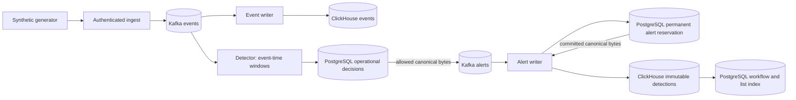

# Architecture

Phase 3 final regression and production-review verification is pending. This
document describes the selected detection/recovery contract; it does not certify
the pending gates. Local scenario evidence is recorded in the
[Plan 13 summary](../.planning/phases/03-detection-alert-pipeline/03-13-SUMMARY.md).

## Running flow

Ingest acknowledges only complete all-ISR publication. Event-writer commits its
partition-contiguous source prefix after ClickHouse acknowledgement. Detector
commits recovery pins after durable decisions and allowed publication; alert-writer
commits after both alert stores succeed. These are independently acknowledged
effects, not a distributed transaction. Identical physical publications/inserts
can repeat; visible identities deduplicate immediately.

The five binaries live under `backend/cmd/`. Query-api currently provides the
authenticated tenant-scoped event lookup. Complete alert APIs, workflow mutation,
JWT/session login, SSE and the analyst dashboard belong to Phase 4. Compose lives
in `deployments/compose/docker-compose.yml`; rules live in `config/rules.yaml`.
`backend/tools/{keyctl,chmigrate,detection-state,check-alerts}` are tools, not
public service endpoints. Dependencies/toolchains remain pinned in the existing
module, lockfiles and images; this slice adds no framework or dependency.

## Event-time rules and identity

All rules include tenant in grouping. The checked-in defaults are:

| Rule | Predicate and entity after tenant | Threshold / window / cooldown |
| --- | --- | --- |
| AUTH_BRUTE_FORCE | `auth.failure`; source IP + nonempty principal | 10 unique events / 300s / 60s |
| PORT_SCAN | `net.connection`; source + destination IP; destination port present | 20 distinct ports / 60s / 30s |
| REQUEST_FLOOD | `net.request`; source IP | 300 unique events / 60s / 30s |
| DENY_SPIKE | `policy.decision`, `action=deny`; source IP | 30 unique events / 120s / 60s |

Windows are epoch-aligned tumbling UTC-millisecond intervals `[start,end)`.
Traffic straddling a boundary is split even if all events occur within one
sliding-window duration. A partition watermark is its maximum valid event time
minus 30s. Equality is accepted; one millisecond older is late and increments
the internal fixed-label `detection_late_events_total` counter. Windows seal when
their end is at or below the watermark. Valid nonmatching records can advance
time; poison records, idle polls and wall clock do not.

The first threshold crossing freezes canonical bytes: rule/version, severity,
summary, accepted unique `event_count`, window bounds, `created_at=window_end`,
and the first at most 20 unique event IDs in source partition order. SCAN's
predicate counts exact ports while evidence counts matching unique events.
Later hits do not change frozen evidence. Canonical alerts omit `detected_at`.

`contracts.DedupeKey` hashes length-prefixed tenant/rule/entity components and
window start. Rule version is excluded; display delimiters do not define the
hash. AUTH parsing preserves the entire principal suffix, including `|` and
Unicode. Input key is `tenant|source_ip`; alert key is `tenant|alert_id`.

## Durable cross-window cooldown

The selected behavior suppresses visible repeat alerts across nearby windows,
not just duplicate candidates inside one window. The immutable candidate includes
the crossing record's event time and real source position internally. Its decision
clock is `max(previous_candidate_time, trigger_occurred_at)`. Suppress below next
eligibility; allow equality. An allow advances eligibility by cooldown; suppression
does not. Neither clock rewinds. A suppressed window cannot retry at expiry.
Later eligible windows retain distinct normal alert IDs.

PostgreSQL operational tables contain decisions, entity/config-scoped cursors and
partition ownership/config fences. A bounded transaction locks the current fence,
validates Kafka generation/member/assignment token/config, and reads any immutable
old decision before consulting the current cursor. Matching old allow/suppress
replay returns its original bytes and outcome; divergent reconstruction or a missing
older decision fails closed. New decisions update cursor/frontier atomically.
No decision transaction spans Kafka publication.

Allow order is PG decision commit → publish stored bytes → all-ISR acknowledgement
→ Kafka checkpoint. Suppress order is PG commit → no alert publication → checkpoint.
Suppressed candidates have no Kafka alert, CH detection or workflow row. The ledger
is operational recovery metadata, separate from CH detection authority and PG
analyst workflow/list authority. It has no automatic GC; durable history can grow
beyond the active cooldown horizon.

## Checkpoints, fencing and bounds

The replay pin is the earliest first offset of every unexpired state, including
fired windows; without live state it equals processed-next. Format 2 couples that
pin to a bounded metadata object with the pre-pin maximum, durable sealed floor,
independent `processed_next`, semantic fingerprint/four versions, four
`rule_effective_from` gates, drained status, and explicit-none or immutable
`decision_frontier` (offset/rule ordinal/alert ID/fingerprint).

Replay seeds lateness from the maximum immediately before the pin and skips
windows already covered by the durable sealed floor. The floor advances only
after complete effects. Restore verifies the frontier's immutable PG decision
and a fence at least that far; PG may legitimately be ahead after a decision
commit crash. Missing/older/mismatched PG history, invalid or trimmed Kafka pins,
truncation and group-generation rollback refuse recovery. New assignment lifetimes
remain pending until complete authoritative offset/history/config validation;
retained cooperative state must preserve its existing token and window state.

Admission limits include 10,000 windows, 4,096 unique IDs/window, 100,000 prefix
entries, 64 MiB accounted state and 1,024 checkpoint bytes. Config accounts for
fetch/concurrency/producer/state against 256 MiB. These are accounting/admission
limits, not a process-RSS or throughput guarantee. Exhaustion stops before unsafe
mutation; it does not evict unexpired evidence. See [operations](operations.md)
and [rules/handover](rules.md) for retention and stopped-owner transitions.

## Alert storage and Phase 4 handoff

Before any CH insert, the writer commits a permanent global-ID reservation in
PG's separate `alert_reservations` operational table. It stores tenant, immutable
fingerprint, canonical payload bytes (1..1,048,576 bytes) and reservation time.
Ordinary UPDATE/DELETE are rejected. There is no expiry, lease, ownership transfer,
sequence, workflow foreign key or automatic GC. Reservation time is not commit
order. This is durable authority for allowed bytes, not a workflow/list row.

Under a per-ID advisory lock, the first transaction validates existing workflow
and reservation authority. With no reservation, one retained-CH preflight chooses
matching orphan bytes or the incoming payload; existing immutable content wins.
The writer inserts and re-reads the reservation, then requires an acknowledged
commit. Any uncertain commit forbids that attempt's CH effect. After releasing
the connection, a second transaction reacquires the lock under the same original
deadline and revalidates the saved claim. There is only one CH preflight per
attempt; the second phase reuses a first-phase result where applicable.

Only the reserved payload may reach CH. CH acknowledgement or matching retained
evidence precedes insert-only workflow creation and source-prefix acknowledgement.
CH failure/uncertainty leaves the permanent claim but no premature workflow/source
completion. Replay resolves commit uncertainty; a reservation alone is not an
acknowledged alert. Equal replay preserves status, assignee, version, seq and
timestamps. Differing tenant/immutable content is quarantined before conflicting
persistence; corrupt saved claims fail operationally rather than poisoning valid
input. Both stores require parameterized tenant/ID boundaries. CH detail/count
reads deduplicate immediately, without merges.

The reservation constrains a late remote effect to previously committed bytes;
it does not promise remote cancellation or exactly-once insertion. The invariant
requires intact PG durability and every active writer using this protocol. The
native ACK-loss proof observes an insert before dropping its result; delayed
pre-visibility completion is a separate controlled model, not an observed native
server pause. Whole-fix review and final regressions remain pending. See the
[reservation evidence](../.planning/phases/03-detection-alert-pipeline/03-ALERT-RESERVATION-EVIDENCE.md)
and [stopped-writer rollout](operations.md#reservation-protocol-rollout).

PG stores denormalized list fields and immutable fingerprint alongside unique
`alert_id`, unique identity-allocated `seq`, status, assignee, optimistic version
and updated time. CH stores evidence. No alert TTL or operational-ledger cleanup
is invented. Sequence allocation is not commit order: a lower seq may commit
after a higher one. Phase 4 must design and prove backfill that handles this;
`seq > last_seen` alone is not a lossless SSE protocol. No stream implementation
is included here. See [ADR 0008](decisions/0008-alert-list-source-and-conflicts.md).
